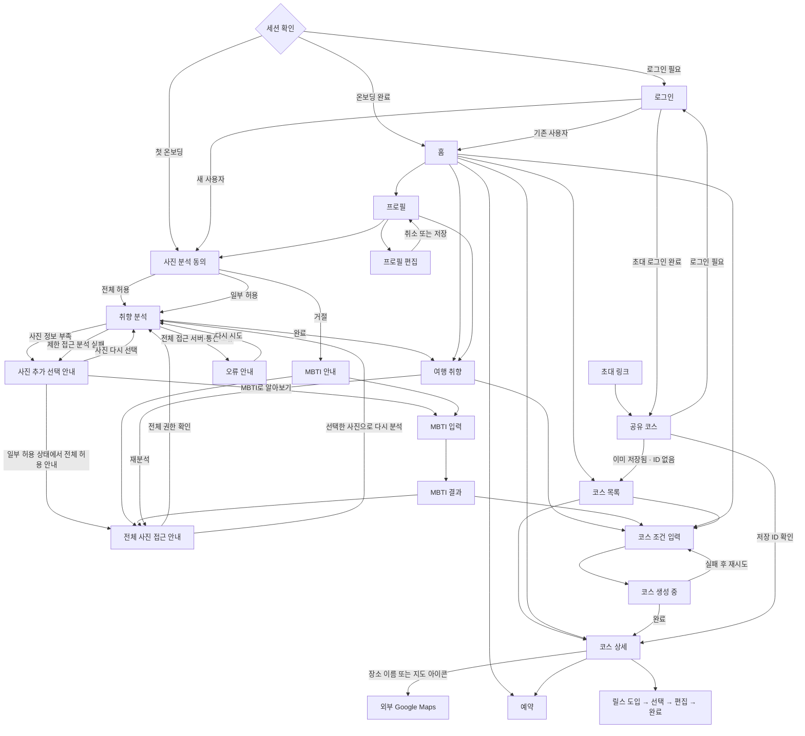

# 앱 내비게이션 흐름

최신 UI v3의 화면 이동과 복귀 규칙입니다. 구현 기준은 `src/navigation/NavigationRoot.tsx`이며, API 계약이나 Figma 원본을 변경하지 않습니다.

| 상황 | 복귀 동작 |
| --- | --- |
| 홈 → 목록 → 상세 → 예약 | 뒤로가기를 누를 때 한 단계씩 복귀합니다. |
| 상세 → 예약 → 상세 | 같은 코스의 Day·통화 선택을 복원합니다. 스크롤 위치는 복원하지 않습니다. |
| 코스 장소 이름 또는 지도 아이콘 선택 | Google Place ID로 외부 Google Maps를 엽니다. 앱 내 이동 기록을 추가하거나 장소 상세 API를 호출하지 않습니다. |
| 프로필 편집 취소/저장 | 프로필로 한 번만 복귀하고, 다음 뒤로가기는 홈으로 갑니다. |
| 프로필/취향에서 사진 재분석 진입 | 동의/권한 안내에 뒤로 버튼을 제공하며, 분석 닫기는 시작한 화면으로 돌아갑니다. |
| 분석 실패 | 처음 분석하는 사용자도 뒤로 버튼과 Android 뒤로가기로 이전 동의/권한 화면에 복귀합니다. 사진 선택 실패 화면에서는 MBTI를 선택할 수 있으며, 이미 전체 접근이면 전체 허용 버튼을 숨깁니다. |
| 설정에서 복귀 | 권한 상태만 새로 확인합니다. 전체 접근 또는 선택한 사진 분석 버튼을 직접 눌러야 분석을 시작하며, 누르기 직전 권한을 다시 확인합니다. |
| 분석 완료 | 유효한 완료 ID를 받으면 연결 종료를 기다리지 않고 완료를 처리합니다. 동의·권한·MBTI 입력 단계를 이동 기록에서 제거합니다. 결과에서 뒤로 누르면 시작한 화면으로 갑니다. |
| 분석 응답 지연 | 응답 헤더 또는 다음 분석 이벤트가 120초 동안 없으면 재시도 가능한 오류로 종료합니다. 제한 접근은 사진 선택 실패 화면으로 이동합니다. |
| Google 로그인 창 취소 | 오류 안내나 서버 로그인 요청 없이 로그인 화면에 머뭅니다. |
| 코스 생성 완료 | 제출한 입력폼·진행 화면을 이동 기록에서 제거합니다. 상세에서 뒤로 누르면 생성 진입 화면으로 갑니다. |
| 실행 중 초대 링크 열기 | 공유 화면을 닫으면 링크를 열기 직전 화면으로 돌아갑니다. |
| 초대 화면에서 로그인 | 같은 초대를 이어서 표시합니다. 거절한 시작 링크를 인증 변경 때 다시 열지 않습니다. |
| 공유 수락 결과에 코스 ID가 없음 | 이전에 보던 다른 코스를 열지 않고 코스 목록으로 이동합니다. |
| 세션 만료/로그아웃 | 로그인으로 이동하고 이전 화면 기록·코스·취향·예약 선택 상태와 개인 조회 캐시를 지웁니다. 취향 조회 키도 계정별로 구분하며, 국가·도시 등 공개 조회 캐시는 유지합니다. |
| 화면을 떠난 뒤 비동기 응답 도착 | 이전 화면의 콜백으로 현재 화면을 이동시키지 않습니다. |
| 릴스 시스템 뒤로가기 | 화면의 뒤로 버튼과 동일하게 선택 → 도입, 완료 → 편집으로 이동합니다. 영상 미리보기는 먼저 닫습니다. |

Android 뒤로가기는 위 이동 기록을 사용합니다. 기록이 없으면 온보딩 완료 사용자는 홈, 미완료 사용자는 사진 동의로 돌아갑니다. 최초 동의 화면에서 뒤로가기로 코스 목록을 우회 진입하지 않습니다. 홈·로그인·최초 동의에서는 두 번 눌러 종료하며, 진행 중인 최초 분석/코스 생성은 기존 이탈 제한을 유지합니다. iOS 왼쪽 가장자리 제스처는 동일한 복귀 함수를 사용합니다.

회귀 검증은 `NavigationFlow.test.tsx`, `NavigationRoot.test.tsx`, `OnboardingBackNavigation.test.tsx`와 각 화면 테스트에서 수행합니다. 실제 OAuth 제공자 로그인과 운영 서버 생성·삭제는 자동 동선 테스트 범위에 포함하지 않습니다.
